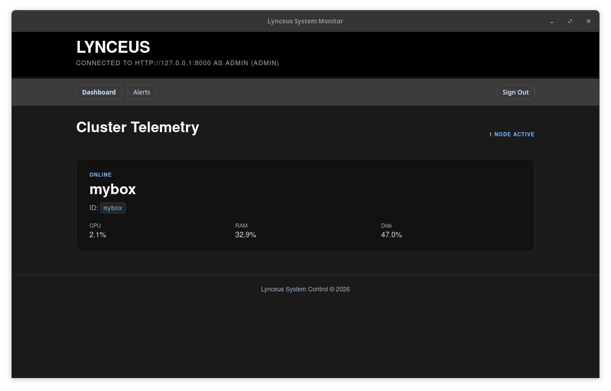
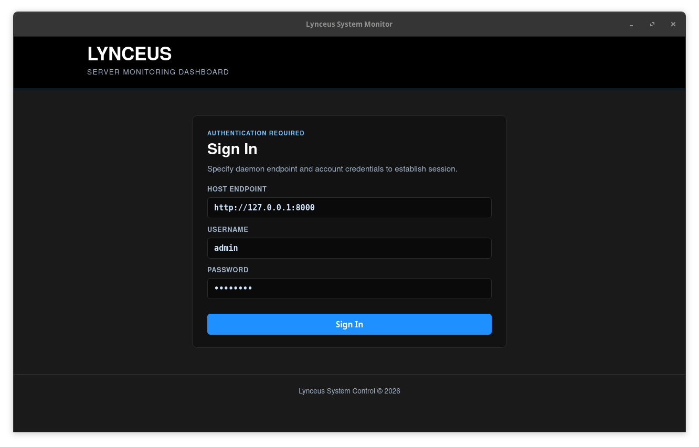
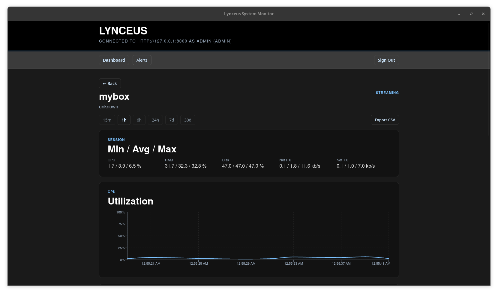
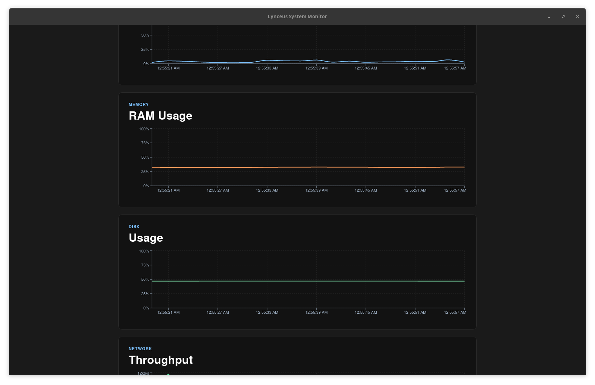
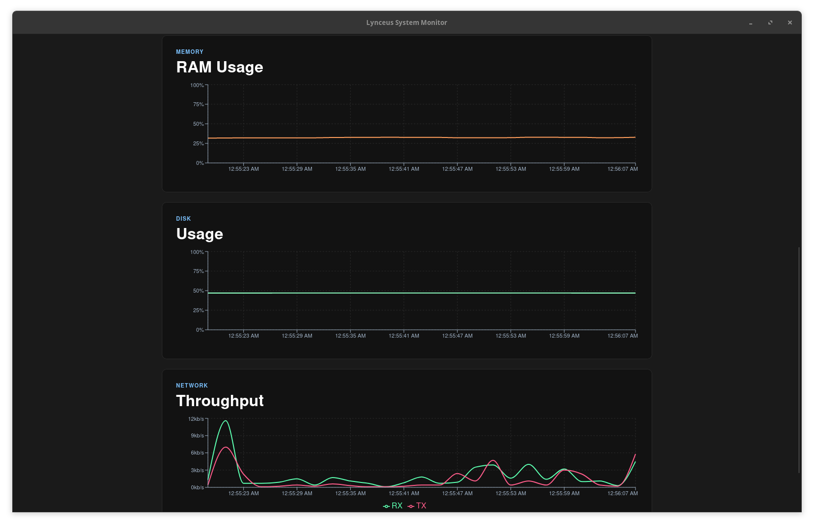
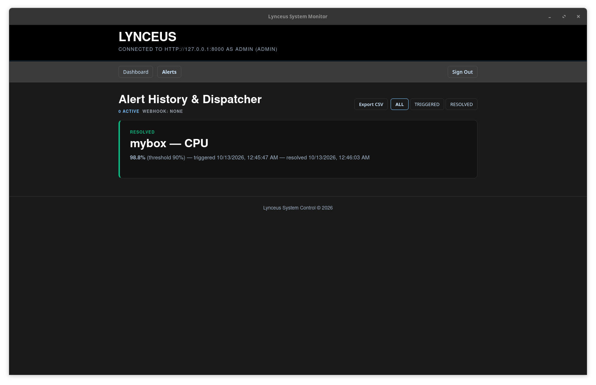

<h1 align="center">Lynceus</h1>

<p align="center">Linux server monitoring with a C agent, a FastAPI backend and a React dashboard.</p>

<p align="center">
<a href="LICENSE"></a>


</p>

<p align="center">

</p>

## Overview

Lynceus collects CPU, memory, disk and network metrics from Linux hosts and shows them live in a web dashboard or a desktop app. A small C daemon runs on each monitored host and streams samples to the backend, which stores them, raises alerts and forwards live data to connected dashboards.

The dashboard only reads. Nothing on a monitored server can be changed from it, so any action that needs to be taken means logging in to the machine. This keeps the exposed surface small and is a deliberate design choice.

The project is under active development and is not yet a replacement for established production monitoring tools. Testers, feedback and contributors are welcome.

## Contents

* [Features](#features)
* [Architecture](#architecture)
* [Screenshots](#screenshots)
* [Requirements](#requirements)
* [Installation](#installation)
* [Configuration](#configuration)
* [Security](#security)
* [Project Status](#project-status)
* [AI Usage](#ai-usage)
* [License](#license)

## Features

* Live CPU, memory, disk and network throughput for every server
* History from 15 minutes up to 30 days
* Alerts for CPU, memory and disk, with hysteresis, acknowledgement and optional acknowledgement expiry
* Offline detection with its own alert and an uptime percentage for each server
* Global alert thresholds, with overrides for each server
* Discord and Slack webhook notifications
* Automatic rollup of old samples into five minute averages and peaks
* CSV export of server history and alert history
* Admin and viewer roles
* Desktop app built with Tauri

## Architecture

Agent. A C11 daemon that reads `/proc/stat`, `/proc/meminfo`, `/proc/net/dev` and the root filesystem, then sends a sample over a WebSocket at a fixed interval (two seconds by default). It reconnects automatically and can run in the foreground, as a daemon, or under systemd.

Backend. A FastAPI application that accepts agent connections, writes samples to the database, evaluates alerts, detects agents that stopped reporting, and broadcasts live data to dashboard clients over WebSockets. It uses SQLite by default and can use PostgreSQL.

Frontend. A React and TypeScript application built with Vite and Recharts. It runs in a browser or inside a Tauri window.

## Screenshots

<p align="center">

</p>

<p align="center">

</p>

<p align="center">

</p>

<p align="center">

</p>

<p align="center">

</p>

## Requirements

Agent

* gcc or clang with C11 support
* CMake 3.10 or newer
* pkg-config
* libwebsockets development headers (`libwebsockets-dev` on Debian and Ubuntu)

Backend

* Python 3.11 or newer
* fastapi, uvicorn[standard], sqlalchemy, alembic, pyjwt, argon2-cffi
* psycopg2-binary, only when using PostgreSQL

Frontend

* Node.js and npm
* For the desktop app, the Rust toolchain ([rustup](https://rustup.rs)) and the Tauri system libraries: `libwebkit2gtk-4.1-dev`, `libgtk-3-dev`, `librsvg2-dev`, `libayatana-appindicator3-dev`, `libsoup-3.0-dev` and `patchelf` on Debian, Ubuntu and PikaOS

## Installation

### Server

```bash
cd server
python3 -m venv .venv
source .venv/bin/activate
pip install -r requirements.txt

export LYNCEUS_JWT_SECRET=$(openssl rand -hex 32)
export LYNCEUS_ADMIN_USERNAME=admin
export LYNCEUS_ADMIN_PASSWORD=changeme
uvicorn app.main:app --port 8000
```

Use the same `LYNCEUS_JWT_SECRET` on every start. A new secret invalidates all signed in sessions.

The database is created and upgraded automatically on startup using Alembic migrations. Back up the database before upgrading.

### Web dashboard

```bash
cd web
npm install
npm run dev
```

Open `http://localhost:5173`, enter the server address, for example `http://127.0.0.1:8000`, and sign in with the admin account.

### Desktop app

```bash
cd web
npm install
npm run build
npx tauri dev
```

The build step must run at least once because Tauri checks that `web/dist` exists when it compiles. Use `npx tauri build` to produce a release bundle.

### Agent

```bash
cd agent
cmake -S . -B build
cmake --build build
./build/lynceus-agent --host 127.0.0.1 --port 8000 --id myserver
```

A server appears in the dashboard the first time its agent connects, named after the id. Add `--key` when the server has `LYNCEUS_API_KEY` set, and `--tls` to connect over `wss`.

Options can also be read from a file with `--config`. An example is in `agent/lynceus-agent.conf.example`. A systemd unit is provided in `agent/lynceus-agent.service`, and `agent/debian` contains Debian packaging.

### Tests

```bash
cd server
pip install -r requirements-dev.txt
pytest
```

## Configuration

The server is configured through environment variables.

| Variable | Default | Description |
|---|---|---|
| `LYNCEUS_JWT_SECRET` | none | Secret used to sign sessions. Required. |
| `LYNCEUS_ADMIN_USERNAME` | none | Initial admin account name, created at startup. |
| `LYNCEUS_ADMIN_PASSWORD` | none | Initial admin account password. |
| `LYNCEUS_API_KEY` | empty | Key agents must send. When empty, agents are not authenticated. |
| `LYNCEUS_DB_URL` | `sqlite:///./lynceus.db` | SQLAlchemy database URL. |
| `LYNCEUS_CORS_ORIGINS` | `*` | Comma separated list of allowed origins. |
| `LYNCEUS_JWT_ACCESS_MINUTES` | `15` | Access token lifetime. |
| `LYNCEUS_JWT_REFRESH_DAYS` | `7` | Refresh token lifetime. |
| `LYNCEUS_LOGIN_MAX_ATTEMPTS` | `5` | Failed logins before lockout. |
| `LYNCEUS_LOGIN_LOCKOUT_MINUTES` | `15` | Lockout duration. |
| `LYNCEUS_CPU_THRESHOLD` | `90` | CPU alert threshold in percent. |
| `LYNCEUS_RAM_THRESHOLD` | `90` | Memory alert threshold in percent. |
| `LYNCEUS_DISK_THRESHOLD` | `90` | Disk alert threshold in percent. |
| `LYNCEUS_ALERT_HYSTERESIS_PERCENT` | `5` | How far below the threshold a value must fall before an alert resolves. |
| `LYNCEUS_OFFLINE_THRESHOLD` | `10` | Seconds without data before a server is considered offline. |
| `LYNCEUS_ACK_EXPIRY_HOURS` | `0` | Hours until an acknowledgement expires. 0 means never. |
| `LYNCEUS_WEBHOOK_URL` | empty | Webhook that receives alert notifications. |
| `LYNCEUS_WEBHOOK_FORMAT` | `auto` | Webhook payload format. `auto` detects Discord and Slack URLs. |
| `LYNCEUS_RETENTION_DAYS` | `7` | Days of raw samples to keep before rollup. 0 disables retention. |
| `LYNCEUS_ROLLUP_RETENTION_DAYS` | `365` | Days of rollups to keep. 0 keeps them indefinitely. |
| `LYNCEUS_ROLLUP_BUCKET_SECONDS` | `300` | Rollup bucket size. |
| `LYNCEUS_RETENTION_INTERVAL_SECONDS` | `3600` | How often the retention job runs. |

Thresholds for a single server can be changed by an admin in the dashboard. They take precedence over the global values for that server.

## Security

Passwords are hashed with Argon2. Sessions use short lived access tokens and a refresh token stored in a cookie that is protected with a CSRF token. Repeated failed logins lock the account for a period. Accounts have either the admin or the viewer role, and only admins can acknowledge alerts, change thresholds or send a test webhook.

For anything beyond local use, set `LYNCEUS_CORS_ORIGINS` to the dashboard origin, set `LYNCEUS_API_KEY`, and run the server behind TLS.

## Project Status

Known gaps:

* The agent reports disk usage for the root filesystem only.
* The agent does not send a hostname or address, so servers are listed by id with an unknown address.

## AI Usage

Large language models, including Claude and Gemini, were used to fix code, write parts of the application and debug connection issues between the server and the app. None of this is exposed in the application or the agent.

## License

Released under the MIT License. See [LICENSE](LICENSE).